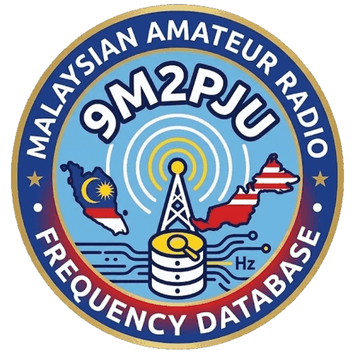
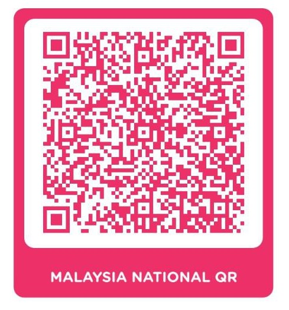

<p align="center">
  
</p>

<h1 align="center">MY-HamFreq</h1>

<p align="center">
  <strong>The curated Malaysian amateur radio frequency database — simplex, repeaters, DMR, APRS &amp; PMR446.</strong><br/>
  Searchable · Mobile-first · Offline-ready PWA · CHIRP-compatible CSV
</p>

<p align="center">
  <a href="https://frequency.hamradio.my"></a>
  <a href="https://hamradio.my"></a>
  <a href="LICENSE"></a>
  
</p>

<p align="center">
  <a href="https://www.buymeacoffee.com/9m2pju"></a>
  <a href="https://www.paypal.com/paypalme/9M2PJU"></a>
  <a href="https://wise.com/pay/me/faizulz13"></a>
</p>

---

## Live site

**Browse:** [https://frequency.hamradio.my](https://frequency.hamradio.my)

| What | How |
|------|-----|
| 🔍 Search | Callsign, frequency, site, tone — press `/` to focus |
| 📍 Near Me | GPS sorts all repeaters by distance |
| 🗂️ Filters | All / VHF / UHF / Simplex / Repeaters / **DMR** / **PMR446** + **state** + **sort** |
| 🃏 Views | Cards (field use) or table (desktop) |
| ⬇️ CSV | One-tap **CHIRP-compatible** download (`9M2PJU.csv`) |
| 📲 Install | PWA — Android/Chrome prompt, iOS Share → Add to Home Screen, offline after first visit |
| 📶 Offline | Cached shell + CSV; offline badge; update toast when a new version ships |

---

## Data at a glance

**206 channels** — every repeater comment is a plain-language summary (site, RX, shift, CTCSS, network). No more `near X, None OPEN`.

| Group | Count | Notes |
|-------|-------|-------|
| 📡 Repeaters (FM) | 113 | VHF −0.6 MHz / UHF −5 MHz, CTCSS listed, MARTS / ASTRA links noted |
| 📻 Repeaters (DMR) | 8 | BrandMeister-linked, no CTCSS confusion |
| 📞 Simplex | 69 | APRS 144.390 · calling 145.500 · V16–V69 · 13 state calling markers (145.000) |
| 🟡 PMR446 | 16 | 446.00625–446.19375 MHz, **0.5 W legal max**, license-free |
| **Total** | **206** | |

Coverage: KL/Selangor (Bukit Lanjan, Gunung Ulu Kali, Genting) · Pahang (Cameron, Fraser, Kuantan) · N. Sembilan (Telapak Buruk) · Penang (Bukit Bendera) · Melaka (Beruang, Ledang) · Johor (Pulai, Banang) · Kedah (Jerai, Langkawi) · Perak (Larut, Kledang, Belum) · Perlis (Kangar) · Terengganu · Kelantan (incl. Gua Musang) · Sabah (Kinabalu, KK, Sandakan, Tawau) · Sarawak (Kuching, Miri, Serian, Borneo Highlands).

Example comment:

```text
9M2RKL FM repeater at Bukit Lanjan — RX 439.600 MHz, shift -5 MHz, CTCSS 203.5 Hz. Open access.
9M2RKL-DMR DMR repeater at Bukit Lanjan — 439.150 MHz (-5 MHz). BrandMeister, open access.
PMR446 CH1 446.00625 MHz FM simplex, license-free (0.5W max). No license required.
```

---

## Pages

| Page | URL |
|------|-----|
| Home (database) | [`index.html`](https://frequency.hamradio.my) |
| FAQ | [`faq.html`](https://frequency.hamradio.my/faq.html) |
| CHIRP Guide | [`chirp-guide.html`](https://frequency.hamradio.my/chirp-guide.html) |
| PMR446 Guide | [`pmr446-guide.html`](https://frequency.hamradio.my/pmr446-guide.html) |
| Bands Guide | [`bands-guide.html`](https://frequency.hamradio.my/bands-guide.html) |
| About | [`about.html`](https://frequency.hamradio.my/about.html) |

---

## Program your radio (CHIRP, 5 min)

1. Download [`9M2PJU.csv`](https://frequency.hamradio.my/9M2PJU.csv) (CSV Export button on site).
2. Install [CHIRP](https://chirp.danplanet.com), connect radio via programming cable, power ON.
3. `Radio → Download From Radio` (so CHIRP learns your model).
4. `File → Import` → select `9M2PJU.csv`.
5. `Radio → Upload To Radio`. Don't disconnect mid-upload.
6. Test on 145.500 MHz (simplex calling) or your nearest repeater.

Full walkthrough with troubleshooting: [CHIRP Guide](https://frequency.hamradio.my/chirp-guide.html). TIDRADIO variant: `TIDRADIO.csv` (same data, no lat/lon).

> ⚠️ You need an MCMC AROC + station licence to **transmit** on amateur bands. PMR446 (0.5 W) is license-free. This database is reference + education, not a licence.

---

## Install as an app (PWA)

- **Android / desktop Chrome/Edge:** tap **Install** in the header (or the install card) → Install.
- **iPhone/iPad (Safari):** Share → **Add to Home Screen** → Add.
- Shortcuts (long-press app icon): Search · Near Me · CSV · Donate.
- Works offline after first visit. If you see **“New version available → Update”**, tap it.

Technically: `manifest.json` (any + maskable icons, shortcuts, `focus-existing` launch handler) + `sw.js` (navigation network-first, assets cache-first, CSV stale-while-revalidate, update toast via `SKIP_WAITING`).

---

## Support — keep it free & ad-free

Hosting, domain, verification trips and CSV upkeep are paid by 9M2PJU. If this saved you time, please chip in. Terima kasih! 73 🇲🇾

<p align="center">
  
</p>

<p align="center"><strong>DuitNow QR</strong> — scan with any Malaysian banking app, TNG eWallet or Grab.<br/>No app? Use the buttons below.</p>

<p align="center">
  <a href="https://www.buymeacoffee.com/9m2pju"></a>
  <a href="https://www.paypal.com/paypalme/9M2PJU"></a>
  <a href="https://wise.com/pay/me/faizulz13"></a>
</p>

- ☕ **BuyMeCoffee:** [buymeacoffee.com/9m2pju](https://www.buymeacoffee.com/9m2pju) — fastest for small one-offs.
- 💙 **PayPal:** [paypal.me/9M2PJU](https://www.paypal.com/paypalme/9M2PJU) — international cards.
- 🌍 **Wise:** [wise.com/pay/me/faizulz13](https://wise.com/pay/me/faizulz13) — low-fee international.
- 📱 **DuitNow:** QR above (`donate_qr_user.jpg` in repo).

The same QR + buttons are on every page (`#donate` section) and in the **Donate** modal (header / bottom nav).

---

## Files

```text
index.html            searchable database (PWA home)
9M2PJU.csv            master data — CHIRP import (Location,Name,Frequency,Duplex,Offset,Tone,rToneFreq,…,Comment,…,Latitude,Longitude)
TIDRADIO.csv          generated — same data, no lat/lon (see export_tidradio.js)
submission-to-openrepeater.csv  generated — repeater-only OpenRepeater format
assets/logo.svg       official logo (vector) · icon-*.png generated from it
donate_qr_user.jpg    DuitNow donation QR
manifest.json / sw.js PWA shell
*.html                guides (faq, chirp, pmr446, bands, about)
build.js              SEO pre-render (tables + JSON-LD) + cache-busting + sitemap
export_tidradio.js / export_openrepeater.js / scripts/merge_repeaterbook.js
```

CSV columns follow CHIRP conventions. `Comment` is human-readable (safe to edit). `Latitude/Longitude` power the map modal + Near Me + OpenRepeater export.

---

## Contribute / corrections

Found a wrong frequency, tone, offset, callsign or site?

1. [Open a data-correction issue](https://github.com/9M2PJU/9M2PJU-MY-HamFreq/issues/new?template=report-frequency.yml) — include frequency + callsign, current vs corrected value, site, source, date checked. (GitHub login required; issues are public — no phone numbers/addresses.)
2. Or PR against `9M2PJU.csv` (keep CHIRP columns; write Comment in the style above).
3. Regenerate: `node export_tidradio.js && node export_openrepeater.js 9M2PJU.csv submission-to-openrepeater.csv` then `npm run build:seo`.

Build: `npm install && npm run build` (SEO + Tailwind). CSS source: `assets/input.css` → `assets/styles.css`.

---

## License

**AGPL-3.0** — see [LICENSE](LICENSE). Data + code are open; if you run a modified public instance, share your changes under the same licence.

Operate within MCMC regulations. 73 de **9M2PJU** — [hamradio.my](https://hamradio.my) · [@9M2PJU](https://x.com/9M2PJU) · happy programming and clear skies! 📻
